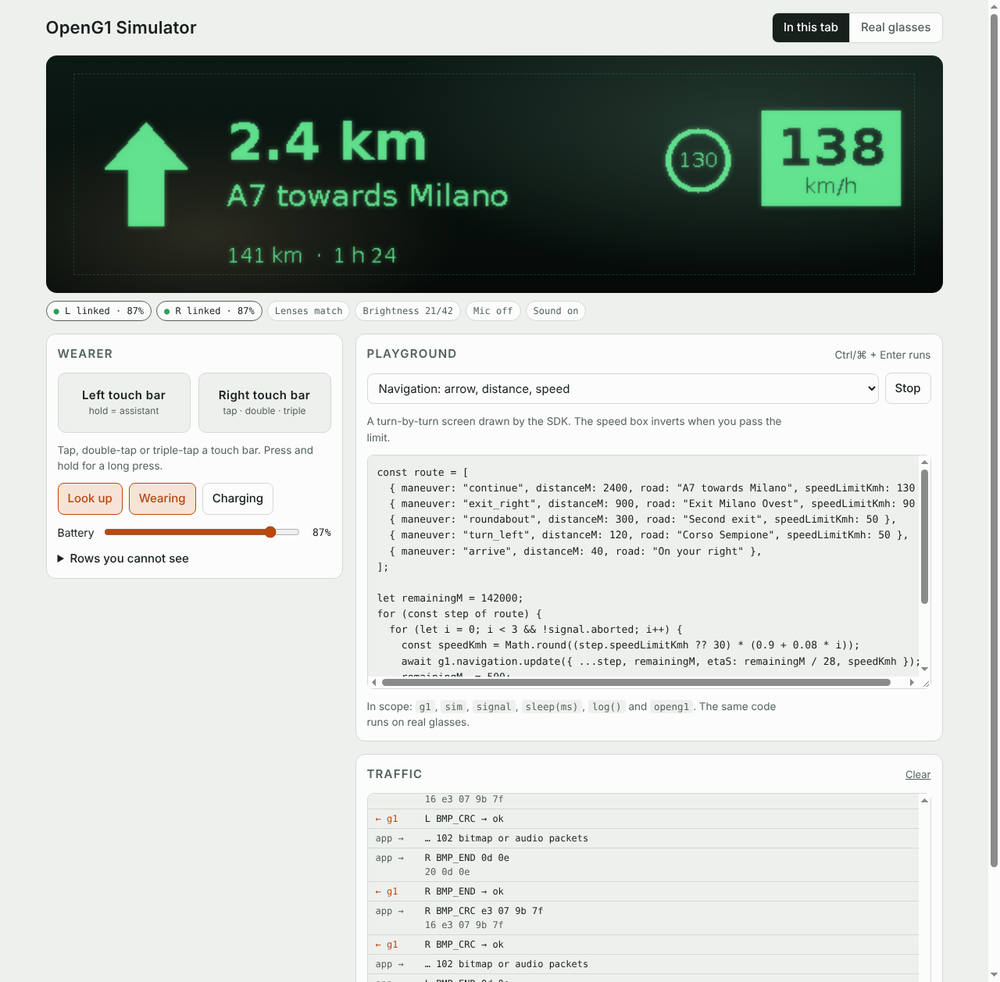

<div align="center">

<picture>
  <source media="(prefers-color-scheme: dark)" srcset="docs/readme/banner-dark.svg">
  
</picture>

<p>
  <a href="#try-it-in-thirty-seconds"><b>Try it</b></a> ·
  <a href="#the-display"><b>Display</b></a> ·
  <a href="#on-a-phone-on-a-computer"><b>Platforms</b></a> ·
  <a href="#the-simulator"><b>Simulator</b></a> ·
  <a href="#the-hub"><b>Hub</b></a> ·
  <a href="docs/API.md"><b>API reference</b></a>
</p>

</div>

OpenG1 is an open SDK and simulator for **Even Realities G1** smart glasses, with one API that works on a computer, on Android and on iPhone. The only line that changes between the simulator and a real pair, or between a laptop and a phone, is the one that opens the connection.

```ts
import { G1 } from "openg1";
import { connectSimulator } from "openg1/transports/ws";

const g1 = await G1.connect(connectSimulator());      // or Web Bluetooth, React Native, Capacitor, noble

await g1.display.text("ciao");
await g1.display.draw((c) => c.text("87", c.width / 2, 20, { font: "xl", align: "center" }));
g1.on("touch", (event) => console.log(event.arm, event.gesture));
```

> [!NOTE]
> The G1 is discontinued and its official software is winding down. OpenG1 exists so the hardware stays useful. **It is not affiliated with Even Realities.**

<picture>
  <source media="(prefers-color-scheme: dark)" srcset="docs/readme/features-dark.svg">
  
</picture>



## Try it in thirty seconds

```sh
git clone https://github.com/gabrielevierti/openg1-sdk && cd openg1-sdk
npm install          # also builds
npx openg1 sim       # → http://127.0.0.1:8765
```

The page shows the 576 × 136 panel as the wearer sees it, two touch bars you can tap, and a playground with six example programs. It works on a phone too, and it can run with no server at all: `dist/web/index.html` is a single self-contained file with the emulator inside.

Then point a program at it:

```sh
node examples/01-hello.ts
```

## What's in the box

| Part | What it is |
| --- | --- |
| **`openg1`** | The SDK: protocol, session and a `G1` object with `display`, `info`, `settings`, `dashboard`, `notifications`, `audio`, `navigation` and `assistant`. Pure TypeScript, no dependencies, runs wherever JavaScript does. |
| **`openg1/sim`** | The simulator as a library: emulated firmware for both arms, a renderer, and the things a wearer does. Runs in Node, in a browser tab or in a test. |
| **`openg1/transports/*`** | How bytes reach the glasses: `web-bluetooth`, `react-native`, `capacitor`, `noble`, plus `ws` and `tcp` for simulators. |
| **`openg1/server`** | A simulator other processes can connect to, and the **hub**: the whole SDK as a JSON API for Swift, Kotlin, Python, Shortcuts or curl. |
| **`openg1` CLI** | `sim`, `hub`, `text`, `image`, `info`, `monitor`, `send`, `demo`, `screenshot`, `scan`, `spec`. |
| **`app/`** | A companion app for iPhone and Android (Capacitor) with its own navigator, teleprompter, notes, mini-apps and settings. See [`app/README.md`](app/README.md). |
| **`python/`** | The original Python SDK, unchanged in behaviour. It connects to this simulator too. |
| **`protocol/`** | The wire protocol as YAML, plus conformance vectors both SDKs must pass. |

## The display

There are two ways to put something on the glasses.

**Firmware text.** `g1.display.text(message)` uses the glasses' own renderer: one size, five lines per screen. The firmware neither wraps nor pages, so the SDK does both for you.

**Bitmaps.** Everything else is a 576 × 136 one-bit image, and `Canvas` is how you make one: lines, boxes, arcs, four font sizes, wrapped text boxes, progress bars and direction arrows.

```ts
await g1.display.draw((c) => {
  const { y, height } = c.safe;                 // the rows this pair can actually show
  c.text("21:47", 16, y + 4, { font: "xl" });
  c.text("Next: stand-up in 12 min", 250, y + 12, { font: "md" });
  c.progress(250, y + height - 30, 300, 14, 0.8);
});

await g1.display.image(imageData, { fit: "contain" });      // any RGBA pixels, scaled and dithered
await g1.navigation.update({ maneuver: "turn_right", distanceM: 350, road: "Corso Sempione", speedKmh: 48, speedLimitKmh: 50 });
```

Depending on how the glasses sit on your face, some rows at the top or bottom of the panel may be hidden. Measure it once and save it in a profile: `c.safe`, `display.image` and the simulator all respect it. See [the rows you cannot see](docs/SIMULATOR.md#the-rows-you-cannot-see).

## Events

```ts
g1.on("touch", (e) => …);        // single_tap, double_tap, triple_tap, hold_start, hold_end; e.arm is "left" or "right"
g1.on("head", (e) => …);         // e.up
g1.on("wear", (e) => …);         // e.worn
g1.on("battery", (e) => …);
g1.on("ai-request", () => …);    // a hold on the left touch bar: the assistant trigger
g1.on("*", (e) => …);            // everything, including packets nobody has decoded yet

const tap = await g1.waitFor("touch", { timeoutMs: 5000 });
for await (const event of g1.events()) { … }
```

## Mini-apps

```ts
import { App, Launcher, runApp } from "openg1";

class Timer extends App {
  override intervalMs = 1000;
  override async start() { await this.screen.show("25:00"); }
  override async onTouch(event) { /* … */ }
  override async tick() { /* … */ }
}

await runApp(new Launcher([new Timer(), new Clock()]), g1);   // triple-tap switches
```

Develop one with live reload using `npx openg1 sim examples/04-app.ts`, or test one without any process at all, as in [`examples/05-testing.test.ts`](examples/05-testing.test.ts).

## On a phone, on a computer

| You have | Use | Notes |
| --- | --- | --- |
| Any browser, no glasses | The simulator page | The emulator runs in the tab. |
| Android, Chrome | The simulator page's **Real glasses** tab, or your own page with `openg1/transports/web-bluetooth` | Needs https or localhost. |
| iPhone | A Web Bluetooth browser (Bluefy) with the same page, or `react-native` / `capacitor` in a native app | Safari has no Web Bluetooth. |
| React Native app | `openg1/transports/react-native` with `react-native-ble-plx` | iPhone and Android. |
| Capacitor / Ionic app | `openg1/transports/capacitor` with `@capacitor-community/bluetooth-le` | iPhone and Android. |
| Computer, Chrome or Edge | Web Bluetooth, as on Android | macOS, Windows, Linux, ChromeOS. |
| Computer, Node | `openg1/transports/noble` | `npm install @stoprocent/noble` |
| Computer, Python | [`python/`](python/) with bleak | The original SDK. |
| Swift, Kotlin, anything else | The hub's HTTP API | The hub holds the connection. |

Details and a snippet for each platform are in [`docs/PLATFORMS.md`](docs/PLATFORMS.md).

### What has been tested, and how

This matters more than the table above, so plainly:

- **The Python SDK** is the implementation that has been used on real glasses.
- **The TypeScript SDK has not been run against real glasses yet.** It agrees with the Python SDK byte for byte: it passes the same 83 conformance vectors, and a parity test compares its command builders, text layout, dithering, BMP files and transfer chunking with Python's output. The two also interoperate in both directions over the simulator link.
- **The Bluetooth adapters** (Web Bluetooth, React Native, Capacitor, noble) are tested against stand-ins shaped like each library's API, with the simulator behind them. That proves the wiring, not the radio. Expect to adjust details, MTU especially, the first time each one meets hardware, and please report what you find.
- **One deliberate difference from the Python SDK:** `display.text` here sends to both arms, left first, as the protocol spec and the official app do. The Python SDK sends text to the left arm only, so if text shows in one lens with Python, that is why. The simulator flags it.

## The simulator

```sh
npx openg1 sim                        # page + endpoints for apps
npx openg1 sim app.ts                 # run your app in it, reload on save
npx openg1 sim --host 0.0.0.0         # reachable from a phone on the same network
npx openg1 sim --top 23               # hide the top 23 rows, as on your pair
```

It emulates the firmware instead of stubbing it: left-then-right ordering, zero-padded replies, text and bitmap reassembly, the bitmap CRC (address bytes included), the 32-second heartbeat timeout and MTU limits. That lets it catch what a byte log can't: a line the firmware would clip, a sixth line it would drop, ink in rows you can't see, a lens left dark, a transfer that would be rejected.

Bitmap screens are pixel-exact. Text screens use a stand-in font because the firmware's own is not published; whether a line fits is judged with the same metrics the SDK uses to lay out text.

Apps connect over WebSocket (`ws://host:8765`), the Python SDK over TCP (`OPENG1_SIMULATOR=1`) and scripts over HTTP (`/api/state`, `/api/frame.png`, `/api/input`). More in [`docs/SIMULATOR.md`](docs/SIMULATOR.md).

## The hub

```sh
npx openg1 hub                # simulator + JSON API
npx openg1 hub --ble          # real glasses + JSON API (needs noble)
```

```sh
curl -X POST localhost:8765/v1/display/text -d '{"text":"ciao"}' -H 'content-type: application/json'
curl localhost:8765/v1/info/battery
curl -N localhost:8765/v1/events        # gestures as server-sent events
```

Custom screens are a JSON list of drawing operations, so no client library is needed in any language. Reference: [`docs/HUB.md`](docs/HUB.md).

## Project layout

```text
src/            the TypeScript SDK
  api/          display, info, settings, dashboard, notifications, audio, navigation, assistant
  sim/          emulated firmware, renderer, simulator
  transports/   web-bluetooth, react-native, capacitor, noble, ws, tcp
  server/       simulator server, hub, PNG
  web/          the simulator page
app/            the companion app for iPhone and Android
python/         the Python SDK and its own in-process simulator
protocol/       openg1.protocol.yaml, vectors.json
tools/          codegen, vector and parity generators, font rasteriser
examples/       programs, an app, a test, phone and hub samples
test/           node --test
```

## Development

```sh
npm test                 # 138 tests, Node 22.18+ (runs the TypeScript directly)
npm run test:python      # the Python SDK's 276
npm run typecheck
npm run build            # dist/, dist/web/index.html, dist/openg1.browser.js
```

The protocol lives in `protocol/openg1.protocol.yaml`, and constants for both languages are generated from it with `npm run codegen`. Every item carries a confidence level (`confirmed`, `observed` or `guessed`), and [`docs/PROTOCOL.md`](docs/PROTOCOL.md) explains the wire format.

## Known limits

- **Firmware updates are not implemented, on purpose.** A bad transfer bricks a device that can no longer be replaced.
- **The firmware's own navigation and teleprompter modes are not used.** Their opcodes are known, their payloads are not. `navigation.update` draws the screen as a bitmap instead, and `navigation.raw()` is there for anyone decoding the real thing.
- **Microphone audio is LC3.** The SDK reassembles it and writes `.lc3` files; decoding to PCM needs a codec you supply.
- **Reconnection is up to you.** A dropped link raises a `disconnect` event; the SDK doesn't reconnect behind your back.

## Contributing

The most useful contribution is a capture from real glasses. Run `npx openg1 monitor --packets --ble`, do the thing, and open an issue with the output, your firmware version and what the glasses showed. See [`CONTRIBUTING.md`](CONTRIBUTING.md).

## Credits

OpenG1 builds on the reverse-engineering work of the G1 community: `even-realities/EvenDemoApp`, `JohnRThomas/EvenDemoApp`, `binarythinktank/eveng1_python_sdk`, `emingenc/even_glasses`, `emingenc/g1_flutter_blue_plus`, `hqrrr/EvenComfort`, `lohmuller/even-g1-java-sdk`, `FJiangArthur/Helix-iOS`, `radioegor146/even-utils`, `Mentra-Community/MentraOS`.

The bitmap fonts are rasterised from DejaVu Sans (Bitstream Vera licence).

## License

MIT. See [LICENSE](LICENSE).

---

<sub>Made by <a href="https://github.com/gabrielevierti">Gabriele Vierti</a> in Milan.</sub>
