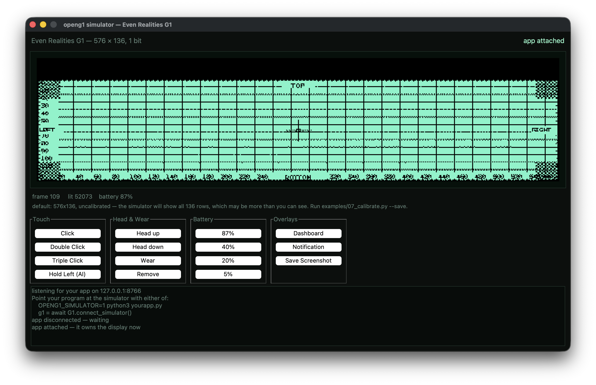

# OpenG1 SDK




An open SDK and visual simulator for **Even Realities G1** smart glasses, in
Python.

The G1 is discontinued. The official app is winding down, and it never did some
of what the hardware is obviously capable of — it will not route a drive from
Genova to Milano, for instance, because long routes were never supported. The
glasses are fine. This exists so people who own a pair can keep building for
them.

Not affiliated with Even Realities.

```python
from openg1 import G1

async with await G1.connect() as g1:
    await g1.display.text("ciao")
    async for event in g1.events():
        print(event)
```

And without owning a pair:

```python
from openg1sim import SimulatedG1

async with SimulatedG1() as sim:
    await sim.g1.display.text("ciao")
    print(sim.panel.frame.to_blocks())     # the panel, rendered, in your terminal
```

## Install

```sh
pip install -e '.[all]'      # or .[ble] .[images] .[audio]
```

| Extra | Pulls in | For |
| --- | --- | --- |
| `ble` | `bleak` | talking to real glasses |
| `images` | `Pillow` | loading PNG/JPEG for the display |
| `audio` | `lc3` | decoding microphone frames to PCM |

With no extras you still get the codec, the session, the emulator, the
simulator and the tests. The protocol layer and the simulator have no
dependencies at all.

## What works

Text with wrapping and pagination, 1-bit images with dithering, the dashboard,
notifications, brightness, silent mode, head-up angle, wear detection, the
microphone with LC3 frame reassembly, touch and head gestures, the Even AI
trigger, battery and firmware queries, and raw packet access for anything not
yet wrapped.

Two things are missing on purpose. **Firmware update** is not implemented —
getting it wrong bricks hardware nobody can replace. **Navigation and
teleprompter payloads** are guesses; the opcodes are right and the glasses
accept them, but the layouts are inferred, so the navigation helpers fall back
to formatted text, which works today. Both are marked `guessed` in the spec.

## Working without hardware

`openg1sim` emulates the firmware and renders the panel. `sim.g1` is an ordinary
`G1`, so anything written against the SDK runs against it unchanged:

```python
from openg1sim import SimulatedG1

async with SimulatedG1() as sim:
    await sim.g1.display.text("ciao")
    print(sim.panel.frame.to_blocks())
```

**Calibrate once, then trust the simulator.** `examples/07_calibrate.py --save`
measures how much of the panel your eye actually gets and writes a device
profile. The simulator dims the rows you cannot see and `display.image()`
letterboxes into the rest — one number, both sides, so what you build in the
window is what reaches the glass. `sim.check_parity()` fails a test the moment
they disagree.

For anything longer than a snippet, run the simulator as its own application
and point your program at it:

```sh
python3 -m openg1sim                      # terminal 1 — the simulator window
OPENG1_SIMULATOR=1 python3 myapp.py       # terminal 2 — restart as often as you like
```

The simulator listens on TCP 8766 for the bytes a BLE write would carry, and
serves the panel at http://127.0.0.1:8765 with buttons for the things a wearer
does. `G1.connect()` honours `OPENG1_SIMULATOR`, so an unmodified hardware
program — including one you did not write — runs against it with no code
change. Full guide: [`docs/SIMULATOR_APP.md`](docs/SIMULATOR_APP.md).

```sh
python3 -m openg1sim             # the window: panel, input buttons, log
python3 -m openg1sim app         # the same, in a browser
python3 -m openg1sim dev app.py  # tighter loop: rerun app.py every time you save
python3 -m openg1sim web         # panel only
python3 -m openg1sim term        # terminal viewer
python3 -m openg1sim demo        # scripted tour
```

Rendering the panel is the point rather than a nicety. A screen can deliver
every packet successfully and still be wrong:

```python
await sim.g1.display.text_page(long_message, page=1, max_page=1)
sim.report().truncated_lines    # 3 — nobody will ever see those lines
```

See [`docs/SIMULATOR.md`](docs/SIMULATOR.md), including two honest notes about
what it does not model.

## CLI

```sh
openg1 scan                  # find a pair
openg1 info                  # firmware, battery, uptime
openg1 monitor               # watch events live
openg1 text "ciao"
openg1 image photo.jpg
openg1 image photo.jpg --safe-area 12,12   # if your panel edges are cut off
openg1 send 0x01 1e00        # raw packet
openg1 spec                  # the protocol table with confidence markers
openg1 --sim demo            # all of the above, against a simulated pair
```

`openg1 monitor` is the most useful thing here for protocol work: unknown
sub-codes print rather than being swallowed, which is how the event table grew.

## Examples

```sh
python3 examples/01_hello.py --sim       # any example, no glasses needed
python3 examples/05_image.py --sim --png # ...and write the panel to a file
python3 -m openg1sim dev examples/09_devapp.py   # live reload
```

Every example takes `--sim`. It is worth using even when you do have the
glasses on: `examples/05_image.bmp` is a calibration chart with `TOP`,
`BOTTOM` and a row ruler, so anything clipped is obvious in the render before
you go looking for it on your face.

| | |
| --- | --- |
| `01_hello.py` | connect, show text, read the battery |
| `02_events.py` | react to taps, head gestures, wear |
| `03_navigation.py` | Genova → Milano with speed limits |
| `04_assistant.py` | hold the left arm, capture audio, answer on screen |
| `05_image.py` | dither and send a bitmap (`--sim` renders it here) |
| `06_simulator.py` | the same screens, rendered as pixels |
| `07_calibrate.py` | measure the visible rows; `--sweep` tries every geometry |
| `08_diagnose.py` | why is my image clipped — bytes lost, or not visible? |
| `09_devapp.py` | a live-reload app for `python3 -m openg1sim dev` |
| `10_starter.py` | **copy this to start your own app** — runs on both, unchanged |

Complete apps, in [`examples/apps/`](examples/apps/):

| | |
| --- | --- |
| `clock.py` | time, date, battery — the pattern for anything self-updating |
| `timer.py` | pomodoro, driven from the touchbar — holding state across events |
| `teleprompter.py` | paged script advanced by tap — layout that adapts to your panel |
| `launcher.py` | all three in one session, switched with a triple tap |

```sh
OPENG1_SIMULATOR=1 python3 examples/apps/launcher.py
```

See **[docs/BUILDING_APPS.md](docs/BUILDING_APPS.md)** for how to write your
own — the framework, four worked patterns, and how to test one.

## Tests

```sh
python3 tests/run_tests.py           # 276 tests, no dependencies
python3 tests/run_tests.py -k text   # filter
pytest                                # also works if you have it
```

The runner is about 200 lines with a small `pytest` stub, so the suite runs
anywhere Python does. 128 cover the SDK, 32 cover the simulator.

## The protocol

`protocol/openg1.protocol.yaml` is the source of truth: 49 commands, 3 events, 11
enums, each with a confidence marker of `confirmed`, `observed` or `guessed`.
`openg1/_generated.py` is generated from it — never hand-edit it.

```sh
python3 tools/codegen.py        # regenerate constants
python3 tools/gen_vectors.py    # regenerate the 83 conformance vectors
```

[`docs/PROTOCOL.md`](docs/PROTOCOL.md) is the human-readable version, including
a section on what is not known.

## Three things that will save you an afternoon

**The framed length counts its own header.** `25 06 00 03` is opcode `0x25`
with a declared length of six — not command `0x25`, sub-command `0x06`. Most
published opcode tables have this wrong in a way that happens to work until a
variable-length command comes along.

**The bitmap CRC covers the storage address.** Hash `00 1C 00 00`, then the
file. A CRC over the file alone is rejected, with no useful diagnostic.

**Left arm first, and wait for the acknowledgement.** The two halves of the
panel update independently. Send both without waiting and the display tears.

**The framebuffer is 576x136 and you should send exactly that.** If an image
comes out clipped, suspect your own transforms before the firmware: anything
that translates a full-size bitmap can only push rows off the edge. When the
panel genuinely does hide rows on your unit — how the glasses sit changes it —
measure with `examples/07_calibrate.py` and pass `safe_area=(top, bottom)` to
`display.image()`, which scales the picture into the band you can read instead
of shifting it out of view.

## Contributing

The most valuable contribution is a packet capture of something the SDK does
not understand yet. Run `openg1 monitor`, do the thing, open an issue with the
bytes.

Bindings for C, C++, Java and TypeScript exist in the full repository, all
checked against the same conformance vectors. This package is the Python half.

## Credits

Built on the work of people who reverse-engineered this hardware first:
`even-realities/EvenDemoApp`, `JohnRThomas/EvenDemoApp` and its wiki,
`binarythinktank/eveng1_python_sdk`, `emingenc/even_glasses`,
`emingenc/g1_flutter_blue_plus`, `hqrrr/EvenComfort`,
`lohmuller/even-g1-java-sdk`, `FJiangArthur/Helix-iOS`,
`radioegor146/even-utils` and `Mentra-Community/MentraOS`.

MIT licensed.

## Documentation

| | |
| --- | --- |
| [docs/SIMULATOR_APP.md](docs/SIMULATOR_APP.md) | develop without wearing the glasses — **start here** |
| [docs/BUILDING_APPS.md](docs/BUILDING_APPS.md) | write an app |
| [docs/SIMULATOR.md](docs/SIMULATOR.md) | the simulator in code |
| [docs/TESTING.md](docs/TESTING.md) | testing the SDK and your app |
| [docs/PROTOCOL.md](docs/PROTOCOL.md) | the wire protocol, with confidence markers |
| [CONTRIBUTING.md](CONTRIBUTING.md) | corrections, captures, codegen |

## Licence

MIT. Not affiliated with Even Realities.
